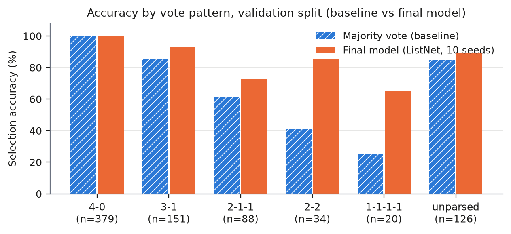
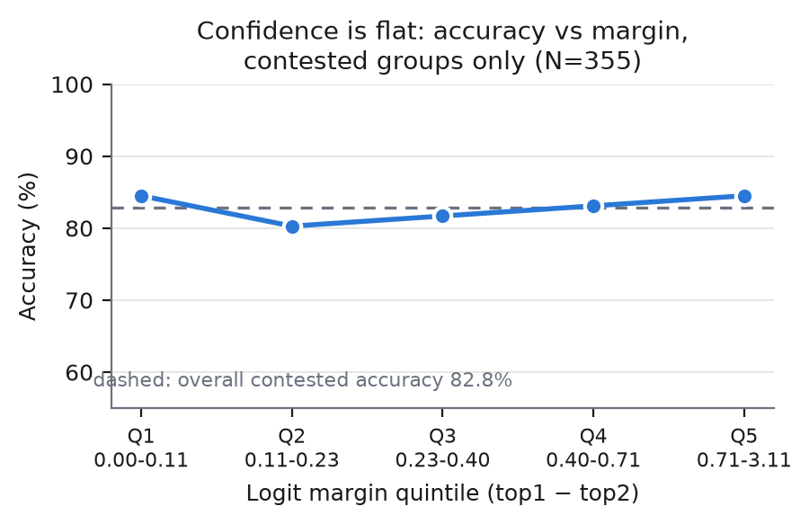

# Selecting Reliable LLM Reasoning: Group-Comparative Linear Scoring over Votes, Trace Embeddings and Question Anchoring

Zhang Yaxing | 3036707458

DASE7506 MP2 | Fall 2026 | frozen submission and reproducibility report | 29 October 2026

Markdown twin of `REPORT.pdf` (7 pages, same content; `report/report.tex` is the source).

## Abstract

Four candidate solutions to the same GSM8K question, generated by a small language
model, frequently disagree on the final number. We build a selector that scores each
candidate with a linear model over group-comparative features: vote agreement among the
four parsed answers, cosine geometry of the supplied frozen trace embeddings, numeric
coverage of the question text, and light style statistics. The scorer is trained with a
ListNet group-softmax objective on the training split only, and ten seed runs are
collapsed into a single linear model by weight averaging. The frozen selector reaches
**92.36%** on validation and **82.66%** on the test bank, against 86.22%/69.16% for a
majority-vote baseline, at 0.32 s wall time and a 26.3 KB inference asset. Ablations show
the gain comes from cross-candidate comparison and trace semantics, not from length or
formatting; a calibration study shows, honestly, that the model's confidence margin does
*not* track its own correctness on contested questions.

## 1. Introduction and summary

Each question ships with four candidate solutions produced by Qwen3-0.6B and a frozen
1024-dimensional embedding per candidate. The scorer awards a point if the *final numeric
answer* of the chosen candidate matches the reference; any correct candidate in a group
earns the point. A group may contain several correct candidates, so the task is
"recognise a good answer among the available ones", not "find the unique right one".

Self-consistency (majority vote over parsed answers) is a strong training-free baseline:
86.22% on validation. It fails exactly where the four candidates disagree, and the test
bank contains *no* unanimous groups by construction, which is why the same rule drops to
69.16% there. All achievable headroom lives in contested groups.

| Method | Validation | Test | Inference cost |
|---|---|---|---|
| Majority vote (training-free) | 86.22 | 69.16 | <0.1 s |
| **Final: linear ListNet, 10-seed avg** | **92.36** | **82.66** | 0.33 s / 26.3 KB |

## 2. Baseline and error analysis

**Baseline.** Parse every candidate's final answer with the supplied `parse_answer`,
count votes, return the lowest-index candidate holding a most-frequent answer; if nothing
parses, return candidate 0. Official scores: 688/798 validation (86.2155%), 323/467 test
(69.1649%).

**Where it fails.** Majority vote is perfect on unanimous groups and degrades
monotonically as the vote fragments; all 110 of its validation errors lie in non-unanimous
groups.

| Vote pattern | #Q | MV wrong | MV err% | Final wrong | Final acc% |
|---|---|---|---|---|---|
| 4 (unanimous) | 379 | 0 | 0.0 | 0 | 100.0 |
| 3-1 | 151 | 22 | 14.6 | 11 | 92.7 |
| 2-1-1 | 88 | 34 | 38.6 | 24 | 72.7 |
| 2-2 | 34 | 20 | 58.8 | 5 | 85.3 |
| 1-1-1-1 | 20 | 15 | 75.0 | 7 | 65.0 |
| with unparsed | 126 | 19 | 15.1 | 14 | 88.9 |
| total | 798 | 110 | 13.8 | 61 | 92.4 |



**Tie-break bias.** The deterministic "lowest index wins" rule is not neutral. On 2-2 ties
the answer held by the lowest-index candidate is correct in 41% of groups while the
*other* tied answer is correct in 53%; on four-way splits the lowest-index candidate is
correct in 25% of groups, exactly the uniform-chance rate. A rule that is merely random
would be acceptable; a rule systematically below the alternative tied answer is free
accuracy given away. (We suspect an ordering artefact of the generator; not verified.)

**Headroom.** Correct-candidate counts per validation group: {1:117, 2:123, 3:179, 4:379};
oracle = 100%. The test bank has no unanimous groups at all, which explains the
baseline's 69.2% and bounds the practical ceiling: the selector must win exactly the
contested cases.

## 3. Method

**Group-comparative features (F = 1047).** Per candidate: 23 handcrafted features plus the
unit-normalised 1024-d trace embedding.

- *Vote agreement (6):* same-answer peer count; parseable flag; group majority size;
  distinct answers; unparsed count; vote margin vs the strongest rival answer.
- *Embedding geometry (7):* with U the unit embeddings and S = UUᵀ the 4×4 cosine matrix:
  mean cosine to the other three; cosine to group centroid; cosine to the majority-answer
  centroid; cosine to same-answer peers and to different-answer candidates (separately);
  cosine-weighted vote margin; raw embedding norm.
- *Question anchoring (3):* fraction of the question's numeric tokens reused; count of
  missed question numbers; count of numbers not in the question.
- *Style (7):* char length (absolute and group-relative), line count, `\boxed`/`####`
  flags, `=` and `$` counts. Kept only to test whether the model leans on formatting.

Features are standardised with train-split statistics (μ, σ stored in the checkpoint).

**ListNet group-softmax objective.** With y the per-candidate correctness against the
train reference, target q = y/Σy (uniform over correct candidates), logits s = w·z + b and
group softmax p, the loss is the listwise cross-entropy plus weight decay:

L = −(1/N) Σ_g Σ_i q_gi log p_gi + λ‖w‖²,  ∂L/∂s = (p − q)/N.

The target matches the metric exactly: any correct pick scores, so probability mass is
spread uniformly over correct candidates. Optimiser: Adam (0.9, 0.999), 256 groups per
minibatch, 800 epochs, lr 0.05, λ = 3e-3, group order shuffled per epoch under
`default_rng(seed)`.

**Seed variance and weight averaging.** Single-seed validation accuracy spans 89.72–92.36%
(mean 90.98%). For linear scorers the logit ensemble is exactly the weight average,
mean_k(z·w_k + b_k) = z·w̄ + b, so ten seeds collapse into one linear model at zero
additional asset or latency cost: 92.36%.

| seed | 0 | 1 | 2 | 3 | 4 | 5 | 6 | 7 | 8 | 9 | mean |
|---|---|---|---|---|---|---|---|---|---|---|---|
| val% | 92.36 | 89.72 | 91.10 | 91.85 | 90.85 | 90.98 | 90.48 | 89.97 | 91.48 | 90.98 | 90.98 |

**Inference.** `predict()` loads w, b, μ, σ, builds features, standardises, returns the
per-group argmax as a Python int. Without a checkpoint it degrades to deterministic
majority vote, so the file alone is a legal training-free baseline.

## 4. Experiments

**Main result.** Frozen selector: 92.36% validation (737/798), 82.66% test (386/467) vs
86.22/69.16 for majority vote: +6.1 pp where easy groups still exist, +13.5 pp on the
all-contested test bank. Gains concentrate exactly where the analysis predicted: 2-2 ties
41.2→85.3%, four-way splits 25.0→65.0%, 3-1 85.4→92.7%. Unanimous groups stay at 100%.

**Ablations** (validation only; identical hyperparameters, ten-seed average; test frozen):

| Variant | F | val % | Stated expectation (before the run) |
|---|---|---|---|
| hand only (no embeddings) | 23 | 89.10 | close to baseline: votes alone cannot read the traces |
| embeddings only (no hand) | 1024 | 89.97 | above chance but below full |
| full − style | 1040 | 92.36 | ≈ full: style should carry (almost) nothing |
| full − anchoring | 1044 | 91.73 | slightly below full |
| **full** | 1047 | **92.36** | — |

*Does reading the reasoning help?* Yes, through two complementary channels: hand features
alone +2.9 pp over the baseline; embeddings alone +3.7 pp (the frozen trace embedding
carries semantic evidence even without sibling information); together +3.3/+2.4 pp over
either block alone.

*Is it a style shortcut?* No. Removing all seven length/format features costs nothing
(92.36%, identical to full). The learned style-block ℓ2 norm is 0.059 against 0.841
(vote), 0.324 (anchor), 0.289 (geometry); the largest single handcrafted weight is the
*parseable* flag (+0.84) — a correctness cue, not a formatting cue.

*Should a solution be judged on its own?* No. Embeddings-only (isolation) reaches 89.97%;
explicit group-comparative structure closes the remaining +2.4 pp, with the largest gains
in the tie patterns where isolation gives the baseline no information at all.

**Rejected variants** (development runs, recorded 2026-10-18, not re-run): MLP 128-hidden
91.35–92.36 (no gain over linear); deviation embeddings u−ū 87–89 (overfits); group
weighting 91.73–91.98 (no gain).

## 5. Analysis: confidence, and where the model still fails

**The model cannot read its own uncertainty.** On contested validation groups (N=355,
accuracy 82.8%), bucketing by logit margin gives a flat curve:

| margin quintile | Q1 | Q2 | Q3 | Q4 | Q5 |
|---|---|---|---|---|---|
| range | 0.00–0.11 | 0.11–0.23 | 0.23–0.40 | 0.40–0.71 | 0.71–3.11 |
| acc% | 84.5 | 80.3 | 81.7 | 83.1 | 84.5 |



Separation P(margin_correct > margin_wrong) = 0.520; ECE over p_top bins = 0.52 (the group
softmax is a ranking loss, not a probability estimator; mean p_top ≈ 0.40 at 92%
accuracy). The overall margin–accuracy relation is inverted because unanimous groups have
near-zero margins by construction and are always correct — the honest calibration question
must be asked within contested groups, where the answer is flat. Making confidence
meaningful would need an explicit calibration or abstention objective; out of scope, since
the task forces a choice on every question. This is the main limitation: the selector is
accurate but not self-aware.

**A failure case study: double counting.** Validation question `gsm8k:47ea45…`: "Texas
Integrated School has 15 classes and has 20 students per class. They added five more
classes, how many students will they have now?" (reference 400). All four candidates agree
on every intermediate quantity — 15×20=300, 15+5=20 classes, 20×20=400 — and split 2-2 only
on the final step: the correct pair *replaces* the old total (400), the wrong pair *adds*
the new total on top of the old one (300+400=700), counting the same students twice. The
model ranks the wrong cluster first (logits +1.74, +1.01 vs +0.93, +0.63), and no feature it
is allowed to use can see why: numeric coverage is identical across all four traces, the
vote is a tie, the geometry is nearly symmetric, and the whole-trace embedding averages the
single decisive addition away. The available evidence is *invariant* to the distinction
that decides the question; step-level features or an arithmetic re-executing verifier would
be needed, both beyond this project's asset and runtime budget.

**Residual errors.** The 61 validation errors sit in 2-1-1 (24), 3-1 (11), unparsed (14),
2-2 (5), four-way (7). Consistent with the case study, cosine to same-answer peers carries
a negative weight (−0.22) once votes are conditioned on — tight same-answer clusters are
mild evidence of shared error — while cosine to the majority centroid is positive (+0.16);
the two partially cancel, likely why those patterns improve least.

## 6. Resources

| Quantity | Limit | Measured (local) |
|---|---|---|
| Inference wall time, fresh predict+score processes | 30 s (reference Xeon 8457C) | 0.33 s median of 3 repeats |
| Inference assets | 16 MiB | 26,347 B |
| Training hardware | CPU or ≤ RTX 4090 | CPU only |
| Training cost, one 10-seed bundle | — | ≈192 s |
| Inference dependencies | — | Python 3.13.9, NumPy 2.5.4 |

Dev machine: AMD Ryzen 7 9800X3D, 8 cores, Windows 11. More computation (MLP, deviation
embeddings) bought nothing; the cheap linear model is also the accurate one.

## 7. Reproducibility

Commands (from `code/`), records in `EXPERIMENTS.md`, `evidence/`, `code/runs/`:

```
python check_data.py
python train.py --variant emb --seeds 10 --out runs/model_bundle
OMP_NUM_THREADS=4 OPENBLAS_NUM_THREADS=4 MKL_NUM_THREADS=4 \
  python predict.py --method submission.py --checkpoint runs/model_bundle \
      --split test --output runs/test-predictions.json
python score_predictions.py --split test \
    --predictions runs/test-predictions.json --output runs/test-score.json
```

Retraining is deterministic: `model.npz` reproduces bit-identically (SHA-256 verified) with
identical per-pattern breakdowns. Audit robustness: `predict()` checked on a shuffled
37-question sub-bank of validation — all choices valid Python ints and identical to the
full-bank run (features are per-group; no order or size dependence). Checkpoint SHA-256:
`e0181539…` (see `ASSET_INVENTORY.json` / `MODEL_CARD.json`).

## 8. Limitations and conclusion

The scorer rewards only the final number, so the method optimises answer-plausibility, not
reasoning validity; a broken intermediate step with a lucky final number is
indistinguishable from a clean one by design of the metric. Embeddings are frozen and the
form is linear (validated by the MLP ablation), capping expressiveness at what these
features separate. Confidence is unusable for abstention or routing. Within those limits,
group-comparative linear scoring turns a 69.2% test baseline into 82.7% with a 26 KB asset
and a third of a second, and the ablations locate the gain precisely: cross-candidate
comparison and trace semantics, not formatting.

## AI assistance and reuse disclosure

Method ideas (group-comparative feature design, ListNet formulation, seed-weight
averaging, experiment plan) were developed in discussion with an AI assistant (Claude,
Anthropic); the author implemented and verified all code after understanding it, ran every
experiment reported here, and takes full responsibility for the submitted implementation
and numbers. No external code, datasets or pretrained weights beyond the supplied package.

## Data attribution

Questions and references derive from GSM8K (MIT license retained in `code/data/`).
Candidate solutions and embeddings prepared with Qwen3-0.6B by the course staff; no model
weights distributed.

## References

1. Cobbe et al., *Training Verifiers to Solve Math Word Problems* (GSM8K), 2021.
2. Cao et al., *Learning to Rank: From Pairwise Approach to Listwise Approach*, ICML 2007.
3. Qwen Team, *Qwen3 Technical Report*, 2025 (candidate generator only).
